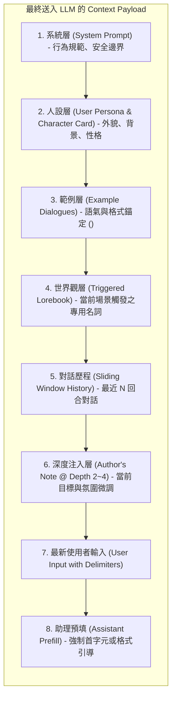

# 上下文組裝管線 (Context Assembly Pipeline)

## 1. 概念定義
在互動式小說與 AI Chat 系統中，傳送給大語言模型（LLM）的輸入並非只有「使用者輸入」與「歷史對話」，而是經過**中介層（Middleware）精密組裝的多層結構化 Payload**。這一整個組裝、剪裁、排序與注入的過程即為**上下文組裝管線**。

---

## 2. 關鍵層級解析

### 2.1 系統規範層 (System Prompt)
宣告世界的物理法則、文風要求（如「第三人稱小說視角」、「詳細描寫環境與心理活動」）及禁止行為。

### 2.2 範例對話層 (Few-Shot Dialogue / `mes_example`)
這是區分「一般聊天機器人」與「高品質小說角色」的最重要技術。大模型具有極強的**上下文格式同化能力（In-Context Learning）**。透過提供 2~3 段包含心理描寫、特殊口癖、語氣詞的 `<START>` 範例對話，能立即將模型的輸出文風鎖定在專業小說水準。

### 2.3 深度注入層 (Author's Note / In-chat Injection)
大模型在處理數千甚至數萬 Token 的長上下文時，容易出現 **「迷失在中間（Lost in the Middle）」** 現象——即模型對 Context 頭部與尾部的注意力權重最高，中間的指令容易被稀釋。
- **Author's Note** 透過將提示詞直接插入在距離對話末端 2~4 則訊息的深度（`@ Depth`），例如：
  `[Author's note: 當前場景氣氛緊張，角色應該表現出猶豫與不安]`
- 此作法能強力校準模型的下一步反應，解決劇情失焦問題。

### 2.4 助理端預填 (Assistant Prefill)
在支援 Prefill 的模型後端（如 Claude API 或開源 vLLM），系統可以在模型開始輸出前，先塞入特定字元（例如 `*深深嘆了一口氣，抬頭看著你*` 或 `{"action":`）。
- **用途**：強制模型接續特定語氣開頭，或保證 JSON 結構化輸出。

---

## 3. 關聯頁面
- [Lorebook (世界書) 機制](../concepts/Lorebook-World-Info.md)
- [角色扮演記憶架構](../concepts/Roleplay-Memory-Architectures.md)
- [SillyTavern](../entities/SillyTavern.md)
