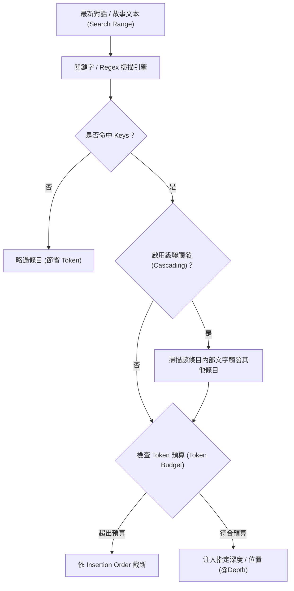

# Lorebook (世界書 / World Info) 動態注入機制

## 1. 概念定義
**Lorebook（世界書）** 是一種專門針對互動小說與角色扮演（RP）設計的**輕量級、基於規則的動態上下文檢索系統**。它的主要目的在於：在不需要將數萬字龐大世界觀一次性塞入 Context Window 的前提下，根據最新情節自動將相關的「人物設定」、「歷史背景」、「地理位置」或「魔法系統」精準注入到 Prompt 中。

---

## 2. 核心運作機制

### 2.1 觸發條件 (Activation Keys & Regex)
每個 Lorebook 條目具備一組關鍵字或正則表達式。
- **Primary Keys**：主要關鍵字（如 `艾蓮娜`, `Elina`）。
- **Secondary Keys (AND / NOT 邏輯)**：次要條件。例如只有在同時出現 `艾蓮娜` 且出現 `城堡` 時才觸發；或者出現 `艾蓮娜` 但排除 `小時候`。
- **Regex Keys**：利用正則表達式捕捉同義詞或動態句型。

### 2.2 搜尋範圍 (Search Range / Scan Depth)
為了避免過去對話歷史中的陳年關鍵字誤觸發，現代系統均支援**掃描範圍限制**（如只搜尋最近 1,000 ~ 4,000 字元或倒數 3 ~ 5 回合）。

### 2.3 級聯觸發 (Cascading Activation / Recursive Scan)
條目之間可具備關聯傳遞性。
- 例如：正文出現 `亞特蘭提斯` $\rightarrow$ 觸發條目 `亞特蘭提斯`。
- 條目 `亞特蘭提斯` 內文包含 `海神三叉戟` $\rightarrow$ 自動遞迴觸發條目 `海神三叉戟`。
- **保護措施**：需設定最大遞迴層數（通常為 2~3 層），防止遞迴爆炸耗盡上下文。

### 2.4 插入位置與順序 (Insertion Position & Order)
- **Insertion Order**：以數值排序，數值大者擁有較高優先權，通常被放置在靠近對話末尾處（注意力權重較高處）。
- **Insertion Depth (@ Depth)**：可將條目精準插入在倒數第 $N$ 則訊息之後，使其對模型的下一個 Token 產生強大的制約力。

---

## 3. Lorebook vs. 向量 RAG 的對比

| 比較維度 | Lorebook (世界書) | 向量 RAG (Vector Search) |
| :--- | :--- | :--- |
| **檢索原理** | 精確關鍵字 / 正則匹配 / 級聯邏輯 | 語意向量相似度 (Cosine Similarity) |
| **狀態確定性** | **極高** (命中關鍵字即 100% 觸發) | 中等 (易受提問語句修飾詞干擾) |
| **時間時序控制** | 可嚴格指定倒數字元與插入深度 | 難以精準區分時序，容易檢索出過期內容 |
| **維護成本** | 需人工或半自動標註關鍵字 | 自動 Embedding 切塊，無需手動設 key |
| **最佳適用場景** | **角色扮演、人設固定、小說道具與世界設定** | 大規模非結構化文件、技術手冊問答 |

---

## 4. 關聯頁面
- [上下文組裝管線 (Context Assembly Pipeline)](../concepts/Context-Assembly-Pipeline.md)
- [SillyTavern](../entities/SillyTavern.md)
- [NovelAI](../entities/NovelAI.md)
