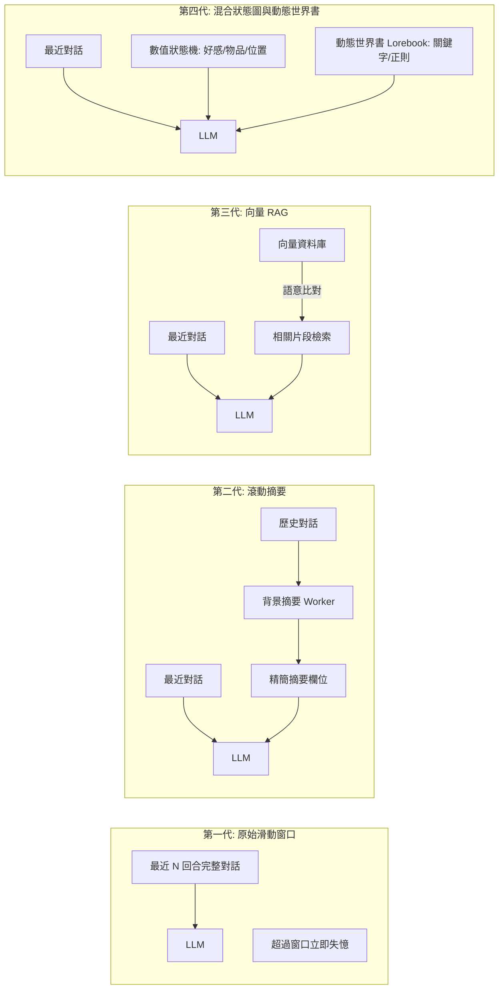

# 角色扮演對話系統的記憶架構演進

## 1. 核心挑戰：敘事時間軸與 Context 限制
在通用問答（如客服、技術支援）中，對話通常是無狀態（Stateless）或短回合的；但在互動小說與角色扮演中，一場冒險可能持續數百至數千回合。

玩家的核心期待：
1. **即時情感共鳴**：角色必須對當下幾句話的情緒和微表情有即時細膩的回應。
2. **長程事實一致性**：角色不能忘記 50 回合前立下的誓言、身上的道具或彼此的稱呼。

---

## 2. 四大記憶機制對比與架構演進

### 2.1 第一代：滑動窗口 (Sliding Window Buffer)
- **原理**：保留最近 $N$ 則訊息（或不超過 $M$ 個 Token），超出者直接丟棄。
- **優缺點**：
  - 優點：成本低、實現極簡單、保留最原汁原味的對話細節。
  - 致命缺點：發生**長期失憶症（Long-term Amnesia）**。

### 2.2 第二代：滾動摘要 (Rolling Summarization)
- **原理**：當歷史紀錄累積到一定長度，啟動非同步小模型將舊對話壓縮成數百字的綱要（Summary），置於 Prompt 頭部。
- **優缺點**：
  - 優點：保留事件大綱，延緩失憶。
  - 致命缺點：**情感細節流失**（模型往往把動人的互動壓縮成「雙方進行了交談並達成共識」），失去沉浸感。

### 2.3 第三代：語意向量記憶 (Semantic Vector RAG)
- **原理**：將所有對話歷史切塊做 Embedding 存入向量資料庫，每回合將當前輸入轉換為向量進行相似度比對檢索。
- **致命缺陷**：
  - **時序混亂 (Temporal Anomaly)**：向量檢索依據的是「詞義相似」而非「時間順序」。若玩家問「我們昨晚吃什麼？」，系統可能檢索出一個月前吃牛排的紀錄，完全違背當前時序。

### 2.4 第四代：混合狀態機 + 動態世界書 (當前主流解法)
- **原理**：
  1. **短期流動**：依賴滑動窗口（保留最新 10~20 回合的完整細節）。
  2. **靜態背景**：依賴 [Lorebook (世界書)](../concepts/Lorebook-World-Info.md) 根據名詞自動喚醒。
  3. **動態狀態 (Key-Value State)**：透過結構化欄位記錄專屬數值（如：當前所在城鎮、持有物品、各角色好感度），每一回合以系統變數即時更新。

---

## 3. 關聯頁面
- [Lorebook (世界書) 機制](../concepts/Lorebook-World-Info.md)
- [上下文組裝管線](../concepts/Context-Assembly-Pipeline.md)
- [Character.ai](../entities/Character-ai.md)
