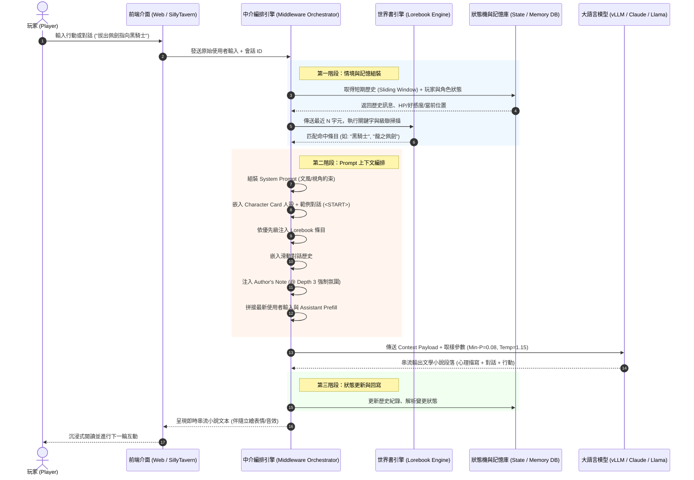

# AI 互動式小說與角色扮演平台：完整技術架構與運作原理全景

## 1. 摘要與全景概覽
「AI 互動式小說」與「角色扮演聊天（AI RP）」表面上看起來像是一個簡單的聊天視窗，但其底層架構與傳統的 RAG 問答機器人有著本質上的不同。

- **傳統 RAG 問答**：使用者提出具體問題 $\rightarrow$ 向量檢索知識片段 $\rightarrow$ LLM 回答客觀事實。
- **互動式小說 / 角色扮演**：使用者輸入行動或對話 $\rightarrow$ **中介層動態合成情境、調度記憶、注入世界書** $\rightarrow$ **利用特化取樣演算法控制文風張力** $\rightarrow$ LLM 輸出具備人設、情感與故事推動力的小說段落 $\rightarrow$ **回寫狀態機**。

---

## 2. 系統端到端資料流架構圖

---

## 3. 四大核心技術柱石

### 柱石一：中介層上下文編排 (The Middleware Orchestration)
詳見：[上下文組裝管線](../concepts/Context-Assembly-Pipeline.md)
- **人設錨定 (Character Grounding)**：透過 Character Card 中的 `mes_example`，以少樣本（Few-shot）示範角色的語氣、內心獨白、口癖。
- **深度注入 (Author's Note @ Depth)**：在大模型容易發生「注意力稀釋（Lost in the Middle）」時，利用倒數第 2~4 則訊息的深度插入關鍵引導詞，強行拉回即時情節節奏。

### 柱石二：世界觀動態檢索 (Dynamic World-Building via Lorebook)
詳見：[Lorebook (世界書) 機制](../concepts/Lorebook-World-Info.md)
- **為什麼捨棄純向量 RAG？** 在小說中，「時序一致性」與「確定性」至關重要。向量 RAG 容易將 100 回合前的舊記憶因關鍵字相似而錯誤撈出，造成時間錯亂。
- **正則與級聯技術 (Cascading)**：當情節提到「魔法學院」，自動喚起學院資料；學院資料內包含「院長名諱」，進一步觸發院長的人設背景，形成遞迴認知網。

### 柱石三：高溫受控解碼 (High-Temperature Controlled Decoding)
詳見：[Min-P 取樣演算法](../concepts/Min-P-Sampling.md)
- **痛點**：低溫生成像枯燥的教科書；高溫生成又會胡言亂語（Hallucination）。
- **解法**：全面以 `Min-P`（例如 `min_p = 0.05 ~ 0.08`）取代傳統 `Top-P`。這允許系統將 `Temperature` 安全拉高至 `1.1 ~ 1.3`，在維持文法與邏輯正確的同時，釋放模型的遣詞造句多樣性與豐沛情感。

### 柱石四：多層複合記憶機制 (Hybrid Memory Strategy)
詳見：[角色扮演記憶架構](../concepts/Roleplay-Memory-Architectures.md)
- 結合**滑動窗口 (最近對話)** + **動態世界書 (名詞背景)** + **結構化狀態槽 (好感度/背包/所在地)**，達成既不超標 Context Window 又能保持長期一致性的黃金平衡點。

---

## 4. 模組化結論（未來 HTML Slide 呈現重點）

| 投影片單元 | 核心講述重點 | 關鍵展示元素 |
| :--- | :--- | :--- |
| **Slide 1: 破題** | 為何傳統 RAG 無法支撐互動式小說與 AI RP？ | 靜態檢索 vs. 動態敘事演進對比圖 |
| **Slide 2: 核心架構** | 中介層（Middleware）在其中扮演的「導演」角色 | 端到端 Mermaid 系統序列圖 |
| **Slide 3: 世界書密碼** | Lorebook 如何用極低成本實現數十萬字世界觀運作 | 級聯觸發 (Cascading) 樹狀圖 |
| **Slide 4: 靈魂關鍵** | 為什麼 Min-P 是讓 AI 寫出有血有肉台詞的必殺技 | 機率分佈曲線動態截斷圖解 |
| **Slide 5: 生態全貌** | 開源 (SillyTavern) 與商用 (Character.ai / NovelAI) 路線比較 | 特色與架構對照表 |

---
## 5. 關聯實體與概念
- [SillyTavern](../entities/SillyTavern.md)
- [Character.ai](../entities/Character-ai.md)
- [NovelAI](../entities/NovelAI.md)
- [Lorebook 機制](../concepts/Lorebook-World-Info.md)
- [Min-P 取樣](../concepts/Min-P-Sampling.md)
- [上下文管線](../concepts/Context-Assembly-Pipeline.md)
- [記憶架構](../concepts/Roleplay-Memory-Architectures.md)
